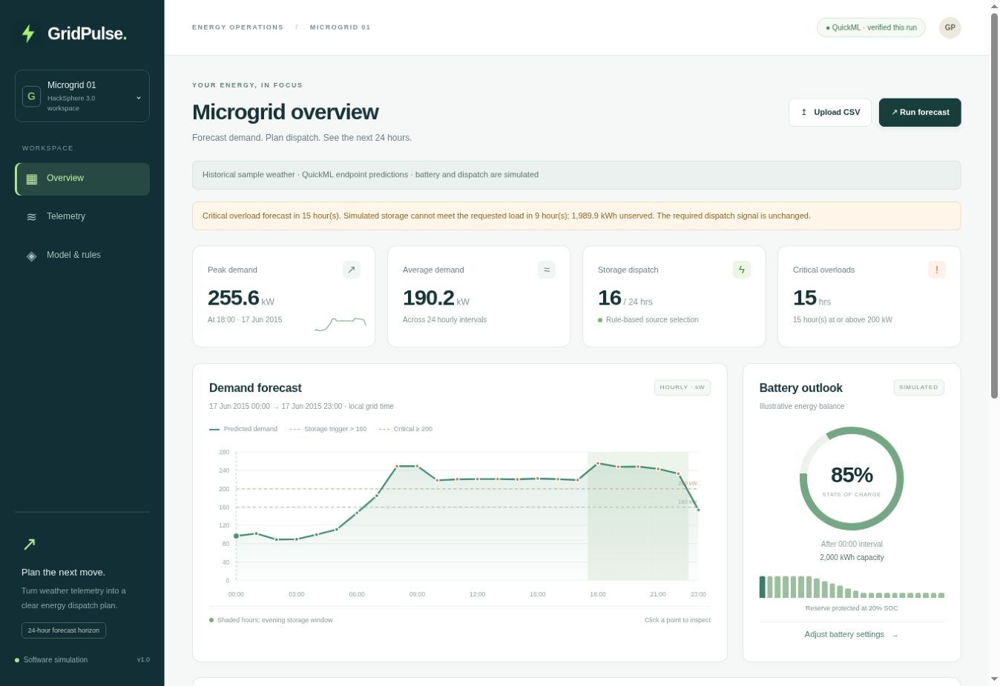

# GridPulse

Smart Energy Microgrid & Demand Forecasting Engine for **HackSphere 3.0**.

**[Open the live Catalyst app](https://gridpulse-50047201220.development.catalystappsail.in/)**

GridPulse turns 24 hourly weather records into demand forecasts using a published
Zoho Catalyst QuickML regression endpoint. It applies the challenge's exact
dispatch rules and shows demand, source transitions, overloads and simulated
battery state in one dashboard.



## Demonstrated workflow

1. Load the supplied historical weather, edit telemetry, or upload a 24-row CSV.
2. Validate timestamps and numeric ranges. Impute missing weather using saved training medians.
3. Build the same 11 numerical features used for QuickML training.
4. Obtain one published-endpoint prediction for each hour.
5. Inspect the dispatch timeline and overload alerts, then export the CSV.

The live check on **27 October 2026** returned 24 finite, nonnegative QuickML
predictions with the original timestamps. All 24 dispatch and overload decisions
matched the required rules. See [the verification record](docs/LIVE_VERIFICATION.json)
and [captured forecast](docs/live_forecast.json). This demonstrates functionality
on historical sample weather. It does not measure hidden-test accuracy.

## Exact controller rules

| Condition | Signal |
|---|---|
| Demand >160 kW OR hour 18 through 22 inclusive | Renewable Storage Mode |
| Otherwise | Main Grid Mode |
| Demand >=200 kW | Critical overload alert, independently of mode |

The controller uses unrounded predictions. Battery limits never silently change
the required signal. The simulator reports energy shortfalls separately.

## Model and evaluation

QuickML pipeline: `GridPulseDemandPipeline`. Model: `GridPulseDemandModel` V1.
Published endpoint: `GridPulseDemandAPI`. Target: `target_demand_kw`.

| QuickML console metric | Reported value |
|---|---:|
| RMSE | 8.2451 kW |
| MAE | 6.6181 kW |
| R2 | 0.9649 |

These values come from the model's console evaluation. The console split was not
independently verified. R2 is not classification accuracy, and hidden-test RMSE
is unknown. The separately trained local development model achieved RMSE
12.2853 kW on an 800-row chronological holdout after fitting 3,200 rows. These
local and QuickML scores use different evaluations and are not directly comparable.

The shared input features are temperature, humidity, solar irradiance, hour,
weekday, month, sine/cosine hour encoding, weekend flag, and heating/cooling
degree features. Inference does not depend on future target values.

## Architecture

| Component | Responsibility |
|---|---|
| HTML, CSS, JavaScript and SVG | Editable weather, charts, timeline and CSV export |
| Catalyst AppSail, Python 3.11 | Validation, shared features, inference orchestration and controller |
| Catalyst QuickML | Published gradient boosting regression endpoint |
| Server environment | Endpoint key and OAuth refresh credentials |

The dashboard uses short background-job requests to avoid holding an AppSail
request open for an entire forecast. In single-record mode, one full forecast
uses 24 prediction calls. Four bounded workers preserve input order. OAuth token
refresh is synchronized. TLS certificate and hostname verification remain on.
Cloud errors propagate without dummy predictions or a local fallback.

Jobs remain in memory in the current AppSail instance. Restarting or replacing
that instance discards pending jobs. Persistent telemetry and multi-instance job
storage are future work.

## Run locally on Windows

Use Python 3.12, 64-bit. The project fits a CPU-based workflow and needs no GPU.

```powershell
py -3.12 -m venv .venv
.\.venv\Scripts\python.exe -m pip install -r requirements.txt
$env:FORECAST_BACKEND = "local"
.\.venv\Scripts\python.exe train.py
.\.venv\Scripts\python.exe app.py
```

Open `http://127.0.0.1:8000`. Local mode supports development and contract checks.
Use QuickML mode for the required published-endpoint inference.

## Configure real QuickML inference

Copy `.env.example` to a private `.env` and set `FORECAST_BACKEND=quickml`.
Set the endpoint key plus OAuth refresh token, client ID and client secret.
The published endpoint URL, region, organization, single-record `data` wrapper
and numerical `result` response path are documented in the example.

```powershell
.\.venv\Scripts\python.exe quickml_smoke.py
.\.venv\Scripts\python.exe app.py
```

Keep credentials out of the repository and browser. In Catalyst, use server
environment variables. Restart the server after configuration changes.
See [the cloud guide](docs/QUICKML_AND_CATALYST.md) and [build guide](BUILD_GUIDE.md).

## Required judging interface

`predict.py` exports `predict(input_df)` and returns exactly one finite numeric
prediction per row, preserving input order. Its CLI writes
`timestamp,target_demand_kw`:

```powershell
.\.venv\Scripts\python.exe predict.py --input sample_test_input.csv --output predictions.csv
.\.venv\Scripts\python.exe test_eval.py
```

The official `test_eval.py` remains unchanged. Its supplied 1,000-row self-test
passed in local development mode. Running the same test in QuickML mode consumes
1,000 single-record prediction requests. Confirm the account allowance first.
Judges must provide the private server credentials through environment variables.

## Tests and evidence

```powershell
.\.venv\Scripts\python.exe -m unittest discover -s tests -v
```

41 automated tests cover validation, exact threshold boundaries, battery limits,
the inference contract, HTTP ingestion, asynchronous jobs, concurrency, OAuth
refresh reuse and safe error messages. Mocked provider tests do not count as live
cloud inference. The separate live record contains the 24-row cloud check.

## Submission files

- [Submission brief and demo sequence](SUBMISSION.md)
- [Editable presentation](presentation/GridPulse_HackSphere_Submission.pptx)
- [Presenter notes](presentation/PITCH_NOTES.md)
- [Local validation details](docs/VALIDATION.md)
- [Official starter](original_starter/), retained for reference

The repository groups the implementation into 15 meaningful commits made during
submission preparation. No historical dates or earlier development sessions are
implied by that organization.

## Scope

Weather comes from the user or supplied historical sample. Battery SOC, PV output
and source switching are software simulations. No physical electrical equipment
is controlled. Potential benefits for campus operators need field validation.
The prototype does not claim measured savings, emissions reductions or blackout
prevention. Cloud free-tier usage limits still apply.
